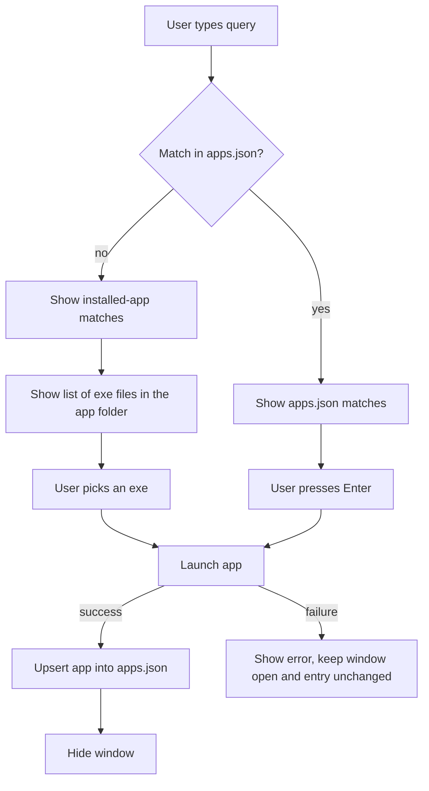

# Plan: User Apps JSON (Frequently Used Apps)

## Summary

Users keep a JSON list of the apps they use daily. Search checks this list first. The system-wide app search runs only when the list has no match.

- Search order: `apps.json` first. If it returns no results, search the installed apps as today.
- Recording: when the user launches an app from search (Enter) and the launch succeeds, the app is saved to `apps.json` and the window hides.
- Each stored app has three fields: `name`, `link` (full path of the exe file the user picked), and `icon` (path to an icon image).

## Current State

- `src/main.rs` builds `AppSearch` from one repository and shows results. It has no launch action.
- `ui/app.slint` has no selected-row state and no Enter handling. Rows show a grey box instead of an icon.
- `AppEntry { name, launch_command, icon_path }` covers `name` and `icon`. `launch_command` holds the Exec string or `.lnk` path today. `link` must be a folder, so discovery also has to provide the folder.
- `PLAN.md` lists "launch on Enter" as an open question. This feature needs it, so Phase 0 implements it.

## Data Format

Location: `apps.json` in the same folder as the FlashBar executable, on both platforms (see Decisions).

```json
{
  "apps": [
    {
      "name": "Code",
      "link": "C:\\Users\\me\\AppData\\Local\\Programs\\Microsoft VS Code\\Code.exe",
      "icon": null
    },
    {
      "name": "Firefox",
      "link": "/usr/bin/firefox",
      "icon": "/usr/share/icons/hicolor/48x48/apps/firefox.png"
    }
  ]
}
```

- A missing file is treated as an empty list.
- `link` (the exe path) is unique. Launching an app that is already stored updates its `name` and `icon`. It does not add a duplicate.
- `icon` may be `null`. The UI then shows the fallback box.
- Entries are sorted alphabetically by `name` (case-insensitive) in the file. Upsert inserts at the sorted position.

## Data Flow



## Layers

Dependencies still point inward. Models depend on nothing. The JSON format (serde) is kept in infrastructure, so models stay free of serialization code.

## 0. Launch on Enter (prerequisite)

Files: `ui/app.slint`, `src/infrastructure/ui/mod.rs`, `src/main.rs`, `src/repository/mod.rs`.

- Add `selected` index to the window. Up and Down move it. Enter calls a `launch-requested(index)` callback.
- Add `AppLauncher` trait in `repository/mod.rs`: `fn launch(&self, app: &AppEntry) -> Result<(), LaunchError>`.
- Implement it per platform in infrastructure:
  - Linux and Windows: start the exe stored in `link` directly, without a shell.
- Add a `LaunchError` variant to `RepositoryError` or a separate error type. Do not panic.

## 1. User App Store (repository and infrastructure)

Repository trait, `src/repository/mod.rs`:

- `UserAppRepository` with `fn load(&self) -> Result<Vec<AppEntry>, RepositoryError>` and `fn save(&self, apps: &[AppEntry]) -> Result<(), RepositoryError>`.

Infrastructure, `src/infrastructure/storage/mod.rs` (cross-platform, path chosen with `cfg`):

- `JsonAppStore` implements `UserAppRepository`.
- Private DTOs `StoredFile { apps: Vec<StoredApp> }` and `StoredApp { name, link, icon: Option<String> }`, using serde derive. Conversion to and from `AppEntry` happens here.
- Reads:
  - Missing file: empty list.
  - Invalid JSON: return an error. Do not overwrite the file.
- Writes:
  - Write to `apps.json.tmp`, then rename over `apps.json`, so a crash cannot leave a half-written file.
  - Create the parent directory if needed.
- Path is `apps.json` next to the running executable (`std::env::current_exe()`), on both platforms. No env vars or extra crate are needed.

## 2. Service (search and launch logic)

File: `src/service/mod.rs`.

- `AppSearch` holds two in-memory lists: `user_apps` (from the store) and `installed_apps` (from the platform repository). Both load once at startup.
- `search(query)`:
  1. Run the existing ranking on `user_apps`.
  2. If that returns nothing, run it on `installed_apps`.
  3. Keep the `MAX_RESULTS` cap.
- `launch(app) -> Result<(), ...>`:
  1. Call `AppLauncher::launch`.
  2. On success, upsert `app` into `user_apps` by `link`, then call `store.save`.
  3. On failure, return the error and change nothing.
- Save errors after a successful launch must not hide the launch. Report them separately.

Unit tests with fake repositories, store, and launcher (same pattern as the current tests):

- A query that matches the user list does not return installed apps.
- A query with no user match falls back to installed apps.
- An empty user list behaves like today.
- Launching a new app adds it to the list and calls save once.
- Launching an app that is already stored updates it and does not duplicate it.
- A failed launch does not change the list and does not call save.
- A stored entry whose exe is missing stays in the list after a failed launch.
- Picking an exe for an installed app stores that exe path as `link`.
- A failed save after a successful launch still returns success for the launch.

## 3. UI

Files: `ui/app.slint`, `src/infrastructure/ui/mod.rs`, `src/main.rs`.

- Extend `ResultRow` with `icon: image` and `has-icon: bool`.
- Load icon images with `Image.load_from_path` when `icon` is set. Otherwise keep the grey box.
- Highlight the selected row.
- Enter on an installed-app result opens an exe picker: a list of the exe files in that app's folder. Up, Down, and Enter choose one. Escape closes the picker.
- Enter launches the selected row. On success the window hides. On failure the window stays open and shows the error text under the search field.

## 4. Wiring

File: `src/main.rs`.

- Build `JsonAppStore`, the platform repository, and the platform launcher.
- Pass them to `AppSearch`.
- Keep `RefCell<AppSearch>` in an `Rc` shared by the query and launch callbacks, since `launch` changes state.

## 5. Windows

- Launching and storing use the same code paths. Only the `AppLauncher` implementation and config path differ.
- Installed apps on Windows currently have `icon_path: None`. Stored apps show the fallback box on Windows (decided, see Decisions).
- Discovery resolves each `.lnk` to its target `.exe` (see Discovery). Entries whose target is not an `.exe` are skipped.
- Mark all Windows code paths as unverified on Linux.

## Discovery (proposed)

### Linux

- Read the `Exec` value from the `.desktop` entry and take its first word, respecting quotes. Field codes are already removed.
- If the word is an absolute path, use it. Otherwise search each directory in `PATH` for an executable file with that name. Use `std` only.
- Skip the entry if no executable is found.
- Skip `flatpak run` and `snap run` entries in this version.

### Windows

- Parse each `.lnk` with the `lnk` crate to read its target path.
- Keep only targets that end in `.exe` and exist on disk.
- Why `lnk` over the `windows` crate (`IShellLink` COM calls): it is pure Rust with no `unsafe`, and its parsing can be tested on Linux. Use the COM route only if `lnk` fails on shortcuts that matter. Check the crate's current version and maintenance before adding it.

## Dependencies to Approve

- `serde` with the `derive` feature, and `serde_json`. Recommended: standard, well-tested JSON handling. A hand-written parser would be error-prone with escaped backslashes and Unicode in paths.
- `lnk`, for Windows `.lnk` parsing (see Discovery). Recommended, after checking the current version.
- Paths use `std::env` and `std::env::current_exe()`. No other crates are planned.

## Phases

0. Enter launches the selected app, with Up and Down selection. Build passes.
1. JSON store with load, save, missing-file, corrupt-file, and atomic-write tests.
2. Service with two-tier search, upsert on launch, and tests.
3. UI icons, selection highlight, exe picker, Linux `Exec` resolution, and main wiring. Manual check with `cargo run` when requested.
4. Windows `.lnk` resolution, launcher, config path, and verification on Windows.

## Verification

- Run `cargo build` and `cargo test` after each phase.
- Test JSON round-trip, missing file, corrupt file, and duplicate `link` values.
- Manual check with `cargo run` only when requested, since it opens the window.
- Windows code cannot be built or run on Linux. Mark it as unverified.

## Risks

- Corrupt `apps.json`: the store refuses to overwrite it and shows an error. Users may need to fix or delete it by hand.
- Stale entries: a stored app may be uninstalled. Launch then fails, an error is shown, and the entry stays. Users remove it by editing the file.
- Linux folders such as `/usr/bin` hold hundreds of executables, so a picker there is hard to use (see Open Questions).
- Flatpak and Snap wrappers resolve to `flatpak` or `snap`, not the app. Those entries are skipped.
- Exec arguments are dropped when storing the exe path. Apps that need them may start differently.
- Wayland and icon paths: stored icon paths can point to files that were removed after a theme update. The UI falls back to the grey box.

## Decisions

1. Fallback: installed apps are searched only when `apps.json` has zero matches.
2. Config location: `apps.json` sits in the folder of the FlashBar executable.
3. `link`: the full path of the exe file the user picked.
4. Ordering: entries in `apps.json` are sorted alphabetically by `name`. Search ranking is unchanged (prefix matches first, then alphabetical).
5. Stale entries: kept in the file. A failed launch shows an error in the window.
6. Windows icons: the fallback box is used for now.
7. After a successful launch, the window hides.
8. Executable choice: the user picks an exe from the list of exe files in the app's folder. The picked path is stored as `link`.

## Open Questions

1. Linux picker: approved. Linux skips the picker and stores the resolved `Exec` file. The picker is used on Windows only.
2. Approval: approved. `serde`, `serde_json`, and `lnk` are in use.

## Known Limitations

- The exe picker shows at most `MAX_RESULTS` (5) rows. There is no scrolling, so later exes in a folder are not reachable.

## Implementation Status

- Phases 0 to 3 are implemented. `cargo build` passes on Linux with no warnings. `cargo test` passes (38 tests).
- Phase 4 (Windows) is implemented and type-checked with `cargo check --target x86_64-pc-windows-gnu`. It is not run on Windows, so it is unverified at runtime.
- Slint UI behaviour (key handling, icons, picker) has not been checked by running the GUI.
